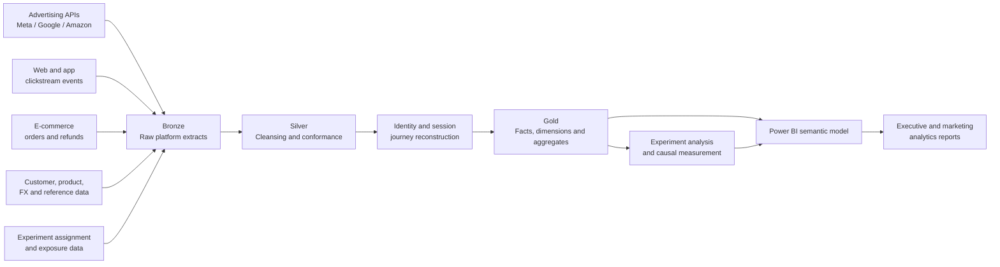
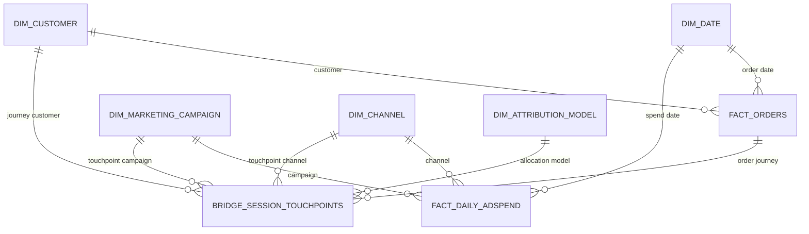
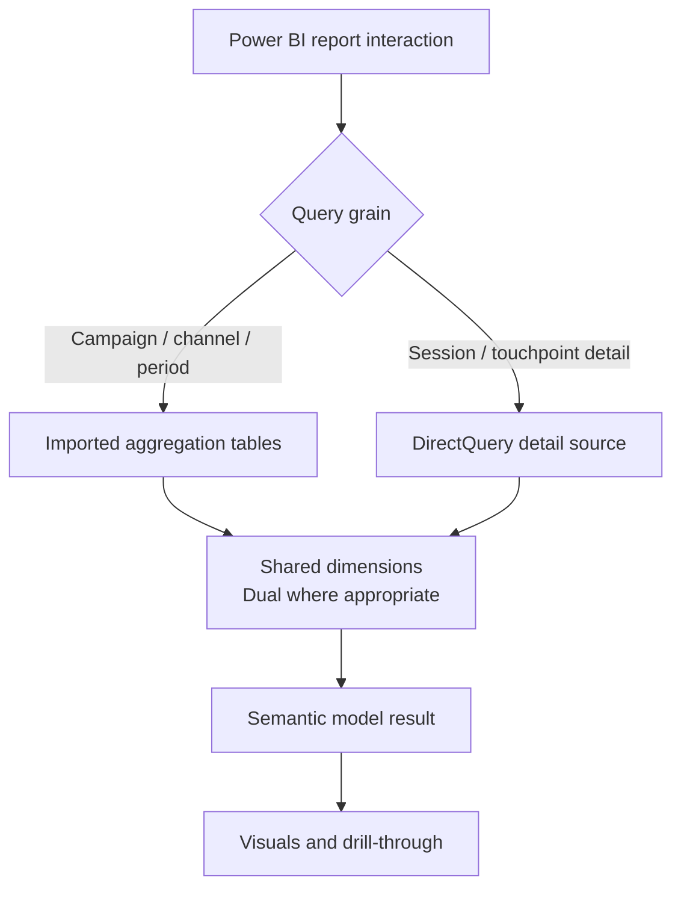

Multi-Touch Attribution & Incremental ROAS (iROAS) Optimizer
> **An enterprise-oriented marketing analytics blueprint for reconciling
> cross-channel attribution, measuring advertising incrementality, and
> optimizing spend against contribution profit and customer lifetime
> value.**


Project type: Proposed enterprise analytics solution  
Industry: E-Commerce  
Domain: Performance Marketing & Growth Analytics  
Primary analytical focus: Multi-touch attribution, incremental ROAS,
campaign profitability, customer acquisition efficiency, and cohort LTV
---
Table of Contents
1. Project Overview
2. Business Problem
3. Solution Objectives
4. Enterprise Data Architecture
4.1 Medallion Data Pipeline
4.2 End-to-End Data Flow
4.3 Data Quality and
Governance
5. Dimensional Data Model
5.1 Proposed Fact and Dimension
Tables
5.2 Model Relationships and
Grain
5.3 Attribution Allocation and
Currency
6. Power BI Composite Model
Architecture
7. Attribution Methodologies
7.1 Attribution Models
7.2 Attribution ROAS vs. Incremental
ROAS
8. KPI and Metric Framework
9. Advanced Power BI
Implementation
9.1 Field Parameters
9.2 Illustrative DAX Measures
9.3 Customer Cohort and LTV
Analysis
9.4 SVG Micro-Visuals
10. Performance Optimization
11. Marketing Budget Optimization: Illustrative Business
Case
12. Power BI Dashboard Design
13. Technology Stack
14. Proposed GitHub Repository
Structure
15. Business Value and Key
Takeaways
16. Assumptions, Limitations, and Implementation
Roadmap
---
1. Project Overview
The Multi-Touch Attribution & Incremental ROAS (iROAS) Optimizer is
a proposed end-to-end analytics solution for e-commerce performance
marketing teams. It brings advertising spend, customer interactions,
orders, and customer value into a governed analytical framework.
The solution is designed to help marketing leaders answer four
questions:
Where did customers interact with our marketing? Reconstruct
customer journeys across paid and other measurable touchpoints.
How is conversion credit allocated? Compare First-Touch,
Last-Touch, Linear, and Time-Decay attribution consistently.
Which advertising activity generated incremental outcomes?
Evaluate lift using randomized holdouts or an appropriately designed
causal-inference method.
Which investments create profitable customer growth? Connect
spend and acquisition cost to contribution margin, retention, and
lifetime value.
The architecture uses a lakehouse-style Medallion pipeline and a Power
BI semantic model. Microsoft Fabric and Azure Databricks are alternative
or combinable implementation platforms, depending on the organization's
existing data estate and operating model.
> **Implementation status:** This README describes a solution blueprint
> and illustrative implementation patterns. No source dataset, deployed
> environment, PBIX file, benchmark, experiment result, or production
> pipeline was supplied with this project brief. Therefore, all
> architecture, tables, DAX, diagrams, and dashboard pages below are
> **proposed or illustrative**, not claims of completed implementation.
Solution at a glance
---
Area                                Proposed capability
---
Data integration                    Advertising platform extracts,
clickstream events, orders,
customer and cost data
Data engineering                    Bronze, Silver, and Gold processing
layers
Attribution                         First-Touch, Last-Touch, Linear,
and Time-Decay allocation
Incrementality                      Holdout-based lift measurement or
credible causal inference
Profitability                       Net contribution, CAC, LTV,
LTV:CAC, and MER
Semantic model                      Dimensional model with
session-touchpoint bridge
Power BI                            Composite model, field parameters,
DAX, cohort analysis, drill-through
Decision support                    Executive reporting and
channel/campaign budget
optimization
---
2. Business Problem
E-commerce advertising platforms such as Meta Ads, Google Ads, and
Amazon Ads independently report conversions and revenue. Their reporting
methodologies, identity resolution, conversion windows, and attribution
rules can differ. A single order may consequently appear in multiple
platform reports.
This creates several analytical challenges:
Conversion overlap: Multiple advertising platforms may claim
credit for the same customer order.
Inconsistent attribution: Channel comparisons become unreliable
when platforms use different attribution windows and rules.
Last-click bias: Lower-funnel interactions can receive
disproportionate credit while earlier discovery activity is
overlooked.
Revenue-only optimization: High revenue or ROAS does not
necessarily mean high contribution profit.
Unproven incrementality: Attributed conversions do not establish
that advertising caused the conversion.
Large event volumes: Clickstream data can contain hundreds of
millions of session and event records.
Cross-market complexity: Currency, time zones, fiscal calendars,
and reporting periods need consistent treatment.
Short-term acquisition focus: Campaign decisions may ignore
retention, repeat purchase behavior, and customer lifetime value.
The proposed solution establishes a common analytical basis for customer
journeys, attribution allocation, experimental lift, and profitability.
It does not assume that platform-reported conversions can simply be
added together.
---
3. Solution Objectives
---
Objective               Analytical approach     Expected decision
support
---
Establish a unified     Standardized campaign,  Compare channels on
view of marketing       channel, spend,         consistent definitions
activity                session, and order data
Reduce duplicated       Centralized order       Avoid summing
conversion credit       identity and allocation incompatible platform
rules                   claims
Compare attribution     Apply multiple models   Understand how model
perspectives            to eligible journey     choice changes channel
touchpoints             credit
Measure incrementality  Randomized holdouts or  Estimate outcomes
validated causal        caused by advertising
inference
Optimize for            Include variable costs  Distinguish revenue
profitability           and contribution margin efficiency from profit
Understand customer     Cohort retention and    Evaluate acquisition
value                   cumulative contribution quality and payback
analysis
Scale reporting         Lakehouse               Support large volumes
transformations and     with governed access
Power BI aggregations
---
4. Enterprise Data Architecture
The recommended architecture separates raw ingestion, conformed
processing, and business-ready analytical data. It can be implemented
with Microsoft Fabric Lakehouse/Warehouse capabilities, Azure Databricks
with Delta Lake, or a combination selected through platform architecture
review.
4.1 Medallion Data Pipeline
Bronze --- Raw ingestion
Purpose: Preserve source data in its received form to support
traceability, replay, and audit.
Potential inputs:
Advertising API extracts from Meta Ads, Google Ads, and Amazon Ads.
Web and app clickstream events.
Session and campaign tagging data, including UTM parameters.
E-commerce orders, order lines, refunds, and cancellations.
Product, customer, and cost reference data.
Experiment assignment and exposure records for incrementality
measurement.
Foreign exchange rates and calendar reference data.
Recommended responsibilities:
Retain source payloads or minimally altered source records.
Capture ingestion timestamp, source system, and batch/run metadata.
Preserve source identifiers and source-reported attribution fields
for reconciliation.
Apply access controls and retention policies appropriate to raw
customer data.
Make ingestion idempotent where possible and support late-arriving
records.
Silver --- Cleansed and conformed data
Purpose: Create reliable, standardized records from heterogeneous
sources.
Recommended transformations:
Normalize timestamps to a canonical time standard while retaining
the source time-zone context needed for reporting.
Standardize campaign and channel mappings using governed reference
data.
Normalize monetary amounts to a reporting currency using an approved
FX-rate policy.
Deduplicate events and orders using source-specific business keys
and deterministic rules.
Validate order status, refund, cancellation, and revenue treatment.
Resolve customer and session identities where permitted by consent,
privacy, and identity-resolution rules.
Reconstruct ordered customer journeys and identify eligible
touchpoints.
Apply consistent attribution eligibility windows and exclusions.
Quarantine malformed, unmatched, or conflicting records rather than
silently discarding them.
Identity stitching must respect consent, applicable privacy law,
platform restrictions, and the organization's data-governance policies.
Anonymous sessions should not be joined to known customers without a
permitted and defensible identity link.
Gold --- Business-ready analytical data
Purpose: Publish governed facts and dimensions optimized for BI and
analytical consumption.
Potential outputs:
Order-level facts with consistent revenue and contribution
definitions.
Daily advertising spend facts at a declared campaign/channel grain.
Session-touchpoint bridge records with attribution allocation
weights.
Pre-aggregated campaign, channel, and time-period performance
tables.
Experiment-level exposed/control outcome summaries and lift
estimates.
Customer acquisition cohort and cumulative contribution datasets.
Data-quality, reconciliation, and pipeline monitoring outputs.
Gold datasets should carry documented grain, metric definitions, refresh
cadence, and lineage. Aggregations must preserve the ability to
reconcile to their underlying detail.
4.2 End-to-End Data Flow

4.3 Data Quality and Governance
A production implementation should define measurable controls before
publishing data to Gold.
---
Control area                        Example validation
---
Completeness                        Required source identifiers,
timestamps, order keys, and
currency codes are populated
Uniqueness                          Duplicate source events and
duplicate order records are
detected using source-specific keys
Referential integrity               Fact foreign keys resolve to valid
dimension members or an explicitly
governed unknown member
Reconciliation                      Spend totals reconcile to accepted
platform extracts under documented
timing and currency rules
Revenue integrity                   Gross sales, discounts, refunds,
cancellations, tax, and shipping
are treated consistently
Journey integrity                   Touchpoints fall within the
eligible journey and attribution
window
Weight integrity                    Allocated touchpoint weights sum to
1 for each eligible order and model
Experiment integrity                Assignment, exposure, eligibility,
and outcome windows follow the
experiment design
Freshness                           Source arrival and Gold publication
meet agreed service-level
expectations
Privacy                             Data access, retention, and
identity resolution comply with
policy and consent
Important: Platform spend and order revenue may not reconcile
exactly on a given day because of reporting latency, time-zone
differences, modeled conversions, refunds, and attribution-window
differences. Reconciliation rules should explain these differences
rather than force artificial equality.
---
5. Dimensional Data Model
The proposed model uses dimensional modeling to support understandable,
performant analysis in Power BI. It separates business events at
different grains and uses a bridge to represent the multiple touchpoints
associated with a customer journey.
5.1 Proposed Fact and Dimension Tables
Fact tables
---
Table                          Proposed grain          Purpose
---
`Fact_Orders`                  One row per canonical   Order revenue, costs,
order                   customer, order date,
and order-level
profitability
`Fact_Daily_AdSpend`           One row per date,       Advertising investment
campaign, channel, and  and delivery metrics
applicable  
source/account grain
`Bridge_Session_Touchpoints`   One row per eligible    Connect journeys to
touchpoint within a     campaigns/channels and
session/order journey   store allocation weight
and attribution-model  
allocation context
The exact physical grain must be finalized from source-system keys and
reporting requirements. If multiple order lines, currencies, ad
accounts, or platform extracts are required, the design may need
additional facts or a more detailed declared grain. Do not mix different
grains in a single fact table.
Dimension tables
---
Table                      Purpose                 Example business
attributes (conceptual)
---
`Dim_Marketing_Campaign`   Campaign descriptors    Campaign name, campaign
and hierarchy           grouping, objective,
platform campaign key
`Dim_Date`                 Consistent calendar and Date, week, month,
fiscal analysis         quarter, year, fiscal
periods
`Dim_Channel`              Governed channel        Channel group, channel
taxonomy                name, paid/owned
classification
`Dim_Customer`             Customer analysis and   Governed customer key
cohorting               and permitted customer
descriptors
`Dim_Attribution_Model`    Attribution model       Model name and model
selection               configuration
These are logical table recommendations, not a supplied physical schema.
Actual columns, data types, keys, and source mappings must be confirmed
during implementation.
5.2 Model Relationships and Grain
A simplified logical relationship view is shown below.

The diagram represents a logical design. In a physical Power BI
model, relationship direction, active status, and bridge implementation
must be validated against the actual keys and filter paths.
Why a bridge table is required
A customer journey can contain multiple touchpoints, and a campaign can
participate in many journeys. This creates a many-to-many business
relationship:
One order may be associated with several eligible touchpoints.
One campaign may influence many customer journeys.
A touchpoint may be evaluated under multiple attribution models.
`Bridge_Session_Touchpoints` resolves this relationship into an
analyzable set of rows. Each bridge row represents a touchpoint's
contribution context. It should include a stable journey/order reference
and the keys required to identify the touchpoint and model allocation.
The bridge avoids a direct many-to-many relationship between orders and
campaigns. It also provides a place to store model-specific allocation
weights. The bridge does not make every possible filter path safe
automatically; ambiguous paths must be avoided in the semantic model.
Attribution weight calculation and allocation
For each eligible order (o) and attribution model (m), let (w_{i,o,m})
be the credit assigned to touchpoint (i).
A valid allocation should satisfy:
[ 0 `\leq `{=tex}w_{i,o,m} `\leq 1`{=tex} ]
[ `\sum`{=tex}{i `\in `{=tex}T(o)} w{i,o,m} = 1 ]
where (T(o)) is the eligible set of touchpoints for order (o) under the
defined attribution window and eligibility rules.
Allocated revenue is:
[ AllocatedRevenue_{i,o,m} = EligibleOrderRevenue_o
`\times `{=tex}w_{i,o,m} ]
The sum of allocated revenue across eligible touchpoints for an order
and model should equal the order revenue basis being attributed. If an
order has no eligible touchpoint, it should be assigned to an explicitly
defined unattributed/direct/unknown treatment rather than silently
omitted or arbitrarily allocated.
Multiple attribution windows
Attribution windows should be governed configuration, not hidden
assumptions. A production design should document:
Lookback duration and whether it differs by channel or campaign
type.
Whether the window is based on click, view, or another eligible
interaction.
Treatment of repeated interactions and duplicate events.
Whether touchpoints after an order are excluded.
Time-zone and timestamp precision rules.
Treatment of direct visits and non-paid channels.
Model version and effective dates.
If multiple windows are compared, the reporting layer must make the
selected window visible. Model comparisons are meaningful only when
eligibility, order population, and revenue basis are controlled.
Referential integrity and relationships
Recommended modeling practices:
Use stable surrogate keys in the warehouse where appropriate;
preserve source identifiers for lineage.
Enforce one-to-many dimension-to-fact relationships wherever the
grain supports them.
Prefer single-direction filtering from dimensions to facts.
Avoid unnecessary bidirectional relationships and multiple active
filter paths.
Use role-playing date dimensions or inactive date relationships for
separate business dates when needed.
Validate that customer and campaign keys in the bridge map to
conformed dimensions.
Use explicit unknown members for late-arriving or unmapped dimension
records, with monitoring.
Currency conversion and net profit
Store the transaction currency and the reporting-currency conversion
basis in the curated data design. Apply an approved FX rate type and
effective-date policy consistently. Avoid summing amounts from different
currencies.
Revenue and profit are not interchangeable. A proposed contribution
calculation is:
[ NetContribution = NetSales - COGS - VariableFulfillmentCost -
PaymentFees - OtherIncludedVariableCosts ]
[ MarketingContribution = NetContribution - AdvertisingSpend ]
The business must define whether taxes, shipping income, discounts,
refunds, returns, and fixed overhead are included. The term Net
Profit in dashboards should only be used if the calculation includes
the organization's approved cost components; otherwise label it
Contribution After Marketing or another accurate name.
5.3 Attribution Allocation and Currency
The recommended allocation process is:
Identify the canonical order and eligible customer journey.
Apply the selected attribution window and touchpoint eligibility
rules.
Deduplicate repeated or invalid touchpoint events according to
documented rules.
Calculate a weight for each eligible touchpoint under each
attribution model.
Validate that weights sum to 1 for each order/model allocation.
Multiply the eligible order revenue basis by the weights.
Aggregate allocated revenue by campaign, channel, date, and
attribution model.
Reconcile allocated totals to the attributed order population.
Currency conversion should occur using a governed FX table and a
documented conversion date policy. For spend and revenue, the chosen
rate date may differ based on accounting and source reporting
requirements; the policy must be explicit.
---
6. Power BI Composite Model Architecture
A composite model can balance interactive analysis and memory use by
combining imported aggregates with DirectQuery detail. The design must
be tested against actual source performance, model size, concurrency,
and user interaction patterns.
---
Component               Proposed storage        Rationale
approach
---
Campaign/day aggregates Import                  Fast executive and
trend reporting
Daily spend and         Import where volume and Common KPI queries can
summarized order facts  refresh needs permit    be served from the
in-memory engine
Granular                DirectQuery where       Avoid importing the
session/touchpoint      near-detail access is   full high-cardinality
detail                  required                event history
Shared dimensions       Dual where supported    Can serve imported and
and appropriate         DirectQuery tables
efficiently
Aggregation tables      Import                  Redirect eligible
summarized queries away
from detail
Detail drill-through    DirectQuery             Retrieve granular
records when users
explicitly need them
Proposed query path

User-defined aggregations
In Power BI, aggregation tables can be configured to answer eligible
summarized queries from imported data while preserving access to the
detail table. The aggregation mapping must align with the detail table's
grouping columns and aggregation functions. Query redirection should be
validated with Performance Analyzer and appropriate model diagnostics.
Terminology note: Power BI commonly refers to this capability as
aggregations or user-defined aggregations. It is not a
substitute for correctly designing the underlying aggregate grain or
validating query hits.
Dual storage mode
Dual mode can allow shared dimensions to behave as Import or DirectQuery
depending on the query plan. It can reduce unnecessary source round
trips in composite models, but it does not guarantee that every query
will be answered from memory.
Design considerations
DirectQuery performance depends on source indexing, query folding,
source concurrency, network latency, and generated SQL.
Imported aggregates need a refresh and reconciliation strategy.
Drill-through detail must be constrained to prevent accidental
unbounded scans.
RLS and security behavior must be tested across all storage modes
and aggregation paths.
Composite model limitations and feature support should be checked
against the selected Power BI capacity, licensing, and source
configuration.
A star schema and predictable filter paths remain essential.
---
7. Attribution Methodologies
Attribution models distribute conversion credit across eligible
marketing touchpoints. They provide different descriptive views of a
journey; they do not, by themselves, prove that a channel caused the
conversion.
Let an eligible order have (n) touchpoints ordered chronologically from
first to last. Let (R_o) be the eligible revenue for that order.
7.1 Attribution Models
1. First-Touch Attribution
Definition: Assigns all conversion credit to the first eligible
touchpoint in the defined customer journey.
[ w_i =
```{=tex}
\begin{cases}
1, & i = 1 \\
0, & i \ne 1
\end{cases}
```
]
Use cases: Understanding discovery and acquisition entry points,
especially where awareness and prospecting are key objectives.
Strengths - Simple to explain and audit. - Highlights channels that
initiate measurable journeys. - Useful as one perspective in a broader
attribution comparison.
Limitations - Ignores subsequent interactions. - Can over-credit the
first measurable interaction. - Sensitive to identity resolution and
lookback-window rules.
2. Last-Touch Attribution
Definition: Assigns all conversion credit to the final eligible
touchpoint before conversion.
[ w_i =
```{=tex}
\begin{cases}
1, & i = n \\
0, & i \ne n
\end{cases}
```
]
Use cases: Understanding the final measurable interaction associated
with conversion and evaluating lower-funnel activity.
Strengths - Straightforward to calculate and communicate. - Useful
for studying conversion-closing interactions. - Often easy to reconcile
to a single credited touchpoint per order.
Limitations - Can over-credit branded search, retargeting, or other
late-journey channels. - Undervalues earlier discovery and
consideration. - Does not establish causality.
3. Linear Attribution
Definition: Distributes credit equally across all eligible
touchpoints.
[ w_i = `\frac{1}{n}`{=tex} ]
Use cases: Journeys where the analyst wants a neutral distribution
across recorded eligible interactions.
Strengths - Recognizes every eligible touchpoint. - Easy to
calculate and explain. - Avoids assigning all credit to a single
interaction.
Limitations - Assumes all touchpoints contribute equally. - Does not
account for timing, quality, or causal impact. - Can reward excessive or
low-quality touchpoint volume.
4. Time-Decay Attribution
Definition: Assigns greater weight to touchpoints closer to
conversion, with credit declining as the time gap increases.
A common illustrative exponential decay function is:
[ u_i = 2^{-`\Delta `{=tex}t_i / h} ]
[ w_i = `\frac{u_i}{\sum_{j=1}^{n} u_j}`{=tex} ]
where:
(`\Delta `{=tex}t_i) is the elapsed time between touchpoint (i) and
conversion.
(h) is the chosen half-life.
(u_i) is the unnormalized weight.
Use cases: Journeys where recent interactions are considered more
influential, such as shorter purchase cycles or tactical campaign
evaluation.
Strengths - Recognizes multiple interactions. - Reflects recency
assumptions explicitly. - Allows the business to tune a half-life
parameter.
Limitations - The half-life is a modeling assumption, not proof of
influence. - May under-credit early awareness activity. - Results are
sensitive to journey completeness and window selection.
Attribution model comparison
---
Model             Allocation rule   Main question     Main limitation
---
First-Touch       100% to first     Which touchpoint  Ignores later
eligible touch    initiated the     interactions
recorded journey?
Last-Touch        100% to last      Which touchpoint  Overweights
eligible touch    was closest to    lower-funnel
conversion?       activity
Linear            Equal credit to   How is credit     Assumes equal
all eligible      shared across     contribution
touches           recorded  
interactions?
Time-Decay        Higher credit to  How does credit   Depends on chosen
more recent       change with       decay function
touches           recency?
7.2 Attribution ROAS vs. Incremental ROAS
Attribution-based ROAS compares revenue allocated to a campaign or
channel under a selected attribution rule with its advertising spend:
[ AttributedROAS = `\frac{AttributedRevenue}{AdvertisingSpend}`{=tex}
]
This is a rule-based allocation of observed revenue. It answers: How
much revenue does this attribution method assign to the campaign
relative to spend?
Incremental ROAS (iROAS) compares the estimated additional revenue
caused by advertising with the incremental advertising cost:
[ iROAS = `\frac{IncrementalRevenue}{IncrementalAdvertisingCost}`{=tex}
]
This answers: How much additional revenue was generated because of the
advertising investment?
True incrementality requires a measurement design, such as:
Randomized audience holdout or geo-experiment.
Treatment and control groups with valid assignment and exposure
definitions.
A pre-specified outcome window and eligible population.
Appropriate handling of non-compliance, contamination, and
spillover.
A credible quasi-experimental or causal-inference design when
randomization is not feasible.
A simple difference-in-means estimate under a valid randomized design
is:
[ IncrementalRevenue = N_T `\times `{=tex}(`\overline{Y}`{=tex}_T -
`\overline{Y}`{=tex}_C) ]
where (`\overline{Y}`{=tex}_T) and (`\overline{Y}`{=tex}_C) are
average revenue per eligible unit in treatment and control, and (N_T) is
the number of eligible treatment units. The precise estimator must match
the experiment design and analysis plan.
Attribution models alone cannot establish incrementality. An
attributed order may have occurred without the advertising exposure. Do
not label attributed revenue as incremental revenue.
---
8. KPI and Metric Framework
Metric definitions should be governed centrally and aligned with Finance
and Marketing. The following definitions are proposed; exact cost
inclusion and cohort conventions must be approved.
---
KPI                     Illustrative definition           Interpretation
---
Total Ad Spend          Sum of eligible advertising spend Investment over the
in reporting currency             selected scope
Attributed Revenue      Sum of order revenue allocated to Revenue credit under a
the selected attribution model    stated rule
Attributed Orders       Distinct eligible orders with     Conversion volume
allocated credit in the selected  credited by the model
scope
Net Profit /            Net sales less approved product   Profitability
Contribution            and variable operating costs      before/after marketing,
depending on the
declared definition
First-Touch ROAS        First-Touch attributed revenue /  First-touch revenue
ad spend                          credit per spend unit
Last-Touch ROAS         Last-Touch attributed revenue /   Last-touch revenue
ad spend                          credit per spend unit
Linear ROAS             Linear attributed revenue / ad    Equal-weight revenue
spend                             credit per spend unit
Time-Decay ROAS         Time-Decay attributed revenue /   Recency-weighted
ad spend                          revenue credit per
spend unit
Incremental Revenue     Estimated                         Revenue estimated to be
treatment-versus-counterfactual   caused by advertising
revenue lift
Incremental ROAS        Incremental revenue / incremental Incremental revenue per
advertising cost                  incremental spend unit
CAC                     Acquisition spend / new customers Cost to acquire a
acquired                          customer under a
defined spend scope
LTV                     Expected or observed customer     Long-term customer
value over a defined horizon      economics
LTV:CAC                 LTV / CAC                         Relationship between
customer value and
acquisition cost
MER                     Total business revenue / total    Blended marketing
marketing spend                   efficiency across the
defined scope
Important metric distinctions
Revenue vs. profit: Revenue does not deduct product costs,
refunds, fulfillment, payment fees, or other expenses. ROAS is not a
profit metric.
Attributed revenue vs. incremental revenue: Attribution
allocates observed revenue; incrementality estimates the
counterfactual difference caused by treatment.
CAC denominator: Specify whether the denominator is all new
customers, paid-acquired customers, or experiment-eligible new
customers. Align the numerator's spend scope to that population.
LTV horizon: Distinguish observed cumulative value from modeled
future value. State whether LTV is revenue-based or
contribution-based.
MER scope: Use consistent business revenue and marketing spend
definitions; MER is a blended ratio and is not channel-level
attribution.
iROAS cost basis: Use incremental advertising cost when the
experiment estimates incremental spend. If the analysis uses total
treatment spend instead, label the metric accordingly and explain
the estimator.
---
9. Advanced Power BI Implementation
The following capabilities are proposed for the semantic model and
report layer. They should be implemented only after the warehouse grain,
relationships, metric definitions, and security requirements are
validated.
9.1 Field Parameters
Field Parameters allow report users to switch measures or dimensions
without maintaining separate visuals for each view.
Attribution model selector
Create a measure field parameter containing the approved attribution
ROAS measures:
First-Touch ROAS
Last-Touch ROAS
Linear ROAS
Time-Decay ROAS
This lets CMOs and analysts compare the same visual under different
allocation methods. Keep the selected attribution model visible in
titles or subtitles so screenshots and exports retain context.
Dynamic time-grain selector
A second field parameter can switch a visual's axis between:
Daily
Weekly
Monthly
Quarterly
Yearly
Use a properly defined date dimension with stable sort columns and a
documented week-start/fiscal calendar policy. Field Parameters are a
Power BI modeling feature; the exact parameter DAX is normally generated
by Power BI Desktop.
9.2 Illustrative DAX Measures
> **DAX assumptions:** The following examples are illustrative patterns,
> not production-ready code for an unknown physical schema. They assume
> the proposed tables and conceptual columns shown below exist with
> compatible data types and relationships. Replace names with the
> validated model names, verify filter propagation, and test totals at
> every reporting grain. In particular, the attribution bridge requires
> one allocation row per eligible order/touchpoint/model context and an
> allocation weight whose sum is 1 per order/model.
Assumed conceptual columns for examples
`Fact_Daily_AdSpend[SpendAmountReportingCurrency]`
`Fact_Orders[OrderKey]`
`Fact_Orders[CustomerKey]`
`Fact_Orders[NetSalesReportingCurrency]`
`Fact_Orders[ContributionBeforeMarketingReportingCurrency]`
`Fact_Orders[IsNewCustomerOrder]`
`Bridge_Session_Touchpoints[OrderKey]`
`Bridge_Session_Touchpoints[AttributionWeight]`
`Bridge_Session_Touchpoints[AttributionModelKey]`
`Bridge_Session_Touchpoints[AllocatedRevenueReportingCurrency]`
`Dim_Attribution_Model[AttributionModelKey]`
`Dim_Date[Date]`
The model must have a valid filter path from the selected dimensions to
the relevant facts. If the bridge does not filter `Fact_Orders` safely,
use a carefully tested measure pattern or materialize allocated revenue
in a Gold fact at the required grain rather than relying on ambiguous
relationships.
Total Ad Spend
``` dax
Total Ad Spend :=
SUM ( Fact_Daily_AdSpend[SpendAmountReportingCurrency] )
```
Attributed Revenue
If allocated revenue is materialized in the bridge at the declared
allocation grain:
``` dax
Attributed Revenue :=
SUM ( Bridge_Session_Touchpoints[AllocatedRevenueReportingCurrency] )
```
If allocated revenue is not materialized, it can be calculated from
order revenue and bridge weights, but the exact DAX depends on the
physical relationship design and duplicate behavior. Do not multiply
order revenue across touchpoint rows without applying the allocation
weight.
ROAS
``` dax
Attributed ROAS :=
DIVIDE ( [Attributed Revenue], [Total Ad Spend] )
```
The selected attribution model must filter the bridge rows used by
`[Attributed Revenue]`. Spend scope and date scope must be aligned to
the reporting definition.
Net contribution before marketing
``` dax
Contribution Before Marketing :=
SUM ( Fact_Orders[ContributionBeforeMarketingReportingCurrency] )
```
Contribution after marketing
``` dax
Contribution After Marketing :=
[Contribution Before Marketing] - [Total Ad Spend]
```
This is not necessarily accounting net profit. It is a contribution
measure based on the cost components included in the source field.
New customers and CAC
``` dax
New Customers :=
CALCULATE (
    DISTINCTCOUNT ( Fact_Orders[CustomerKey] ),
    Fact_Orders[IsNewCustomerOrder] = TRUE ()
)
```
``` dax
Customer Acquisition Cost :=
DIVIDE ( [Total Ad Spend], [New Customers] )
```
The new-customer flag must be derived using an approved first-purchase
definition. The spend filter context must match the customer acquisition
population and period.
LTV
A simple observed contribution LTV pattern for the selected customer
population and observed date scope:
``` dax
Observed Contribution per Customer :=
DIVIDE (
    [Contribution Before Marketing],
    DISTINCTCOUNT ( Fact_Orders[CustomerKey] )
)
```
This is an average over the current filter context, not a predictive
lifetime value model. A production LTV calculation should anchor
customers to acquisition cohorts, define the observation horizon, handle
incomplete cohorts, and state whether future value is modeled.
LTV:CAC
``` dax
LTV to CAC :=
DIVIDE ( [Observed Contribution per Customer], [Customer Acquisition Cost] )
```
Only compare values with compatible populations, time horizons, and cost
definitions.
MER
``` dax
MER :=
DIVIDE (
    SUM ( Fact_Orders[NetSalesReportingCurrency] ),
    [Total Ad Spend]
)
```
This example uses the selected business revenue scope. In a production
report, ensure the numerator is not accidentally filtered to only
attributed orders.
Incremental ROAS
For an experiment summary table with a precomputed, validated
incremental revenue estimate and incremental spend estimate:
``` dax
Incremental ROAS :=
DIVIDE (
    SUM ( Fact_Experiment_Summary[IncrementalRevenueReportingCurrency] ),
    SUM ( Fact_Experiment_Summary[IncrementalAdSpendReportingCurrency] )
)
```
`Fact_Experiment_Summary` is a conceptual dependency for this example
and is not one of the core physical tables specified in the proposed
model. It represents an optional Gold output that should be added only
if experiment reporting is in scope and the experiment design is
documented. Do not calculate iROAS from attribution weights.
Previous-period ROAS
For a date table marked as a date table and a supported date
relationship:
``` dax
Previous Period ROAS :=
CALCULATE (
    [Attributed ROAS],
    DATEADD ( Dim_Date[Date], -1, MONTH )
)
```
This example compares with the previous calendar month. For week, fiscal
period, or custom comparison logic, use the corresponding governed date
attributes and validate the behavior with the chosen calendar.
DAX validation checklist
Confirm that date filters reach spend, orders, and allocation data
as intended.
Confirm that campaign and channel filters do not duplicate order
revenue.
Validate attribution weights sum to 1 by order and model.
Test grand totals against source-level reconciliation outputs.
Use `DIVIDE` for safe ratio calculations.
Avoid using `ALL` or removing filters unless the business definition
explicitly requires it.
Review query plans and visual performance with representative data
volumes.
9.3 Customer Cohort and LTV Analysis
A cohort analysis groups customers by their acquisition period and
evaluates subsequent behavior over a common elapsed-time basis.
Proposed cohort logic
Determine each customer's first eligible purchase date.
Assign the customer to an acquisition month (or another governed
cohort period).
Calculate elapsed days or months from acquisition.
Aggregate repeat orders, net sales, and contribution by cohort and
elapsed period.
Compare cumulative contribution with the initial acquisition cost.
Identify when cumulative contribution covers acquisition cost,
subject to the chosen cost allocation policy.
Suggested analytical outputs
---
Output                              Definition / purpose
---
Acquisition cohort                  Month in which the customer first
qualifies as acquired
Day 30 performance                  Observed outcomes within the first
30 days after acquisition
Day 60 performance                  Observed outcomes within the first
60 days
Day 90 performance                  Observed outcomes within the first
90 days
Cumulative net margin               Accumulated contribution over the
cohort's elapsed period
Initial acquisition cost            Acquisition spend allocated to the
cohort under a documented rule
LTV:CAC                             Cohort value divided by acquisition
cost
Payback period                      First elapsed period when
cumulative contribution meets or
exceeds acquisition cost
Cohorts with insufficient observation time should be marked as immature
rather than compared directly with fully observed cohorts. Day 30, 60,
and 90 values should use consistent elapsed-day definitions;
calendar-month buckets are not always equivalent to fixed-day windows.
Disconnected parameter tables
Disconnected parameter tables can let users choose:
Day 30, Day 60, Day 90, or another observation horizon.
Revenue-based versus contribution-based LTV.
Cohort month or quarter.
Observed-only versus approved modeled LTV.
The selected parameter is read by a measure and applied to the cohort
calculation. Keep parameter tables disconnected when they are intended
only to control measure logic; do not create relationships merely to
make a slicer work.
Payback interpretation
A cohort has reached observed payback when cumulative contribution
attributable to that cohort is at least equal to the acquisition cost
assigned to it. This is a management metric, not necessarily a cash
payback measure. A cash-based payback calculation may require settlement
timing, working-capital effects, and a more detailed cost model.
9.4 SVG Micro-Visuals
Power BI measures can return SVG data URIs for display in supported
image URL contexts. This can provide compact visual cues inside a
campaign matrix.
Potential uses:
14-day ROAS trend sparklines.
Campaign spend-pacing indicators.
Conditional performance indicators.
Compact status visuals in campaign tables.
Illustrative SVG-based DAX example
The following is a minimal illustrative sparkline pattern. It assumes a
date dimension, a `[Daily ROAS]` measure, and a visual context that
contains one campaign. It should be tested for empty dates, zero values,
filter context, and output length before use.
``` dax
ROAS Sparkline SVG :=
VAR Points =
    ADDCOLUMNS (
        DATESINPERIOD ( Dim_Date[Date], MAX ( Dim_Date[Date] ), -13, DAY ),
        "__Value", CALCULATE ( [Daily ROAS] )
    )
VAR ValidPoints =
    FILTER ( Points, NOT ISBLANK ( [__Value] ) )
VAR MinValue =
    MINX ( ValidPoints, [__Value] )
VAR MaxValue =
    MAXX ( ValidPoints, [__Value] )
VAR PointCount =
    COUNTROWS ( ValidPoints )
VAR Coordinates =
    CONCATENATEX (
        ADDCOLUMNS (
            ValidPoints,
            "__X",
                4 + 92 * DIVIDE (
                    RANKX ( ValidPoints, Dim_Date[Date], , ASC, DENSE ) - 1,
                    MAX ( 1, PointCount - 1 )
                ),
            "__Y",
                26 - 22 * DIVIDE (
                    [__Value] - MinValue,
                    MaxValue - MinValue,
                    0.5
                )
        ),
        FORMAT ( [__X], "0.0", "en-US" )
            & ","
            & FORMAT ( [__Y], "0.0", "en-US" ),
        " ",
        Dim_Date[Date],
        ASC
    )
VAR Svg =
    "<svg xmlns='http://www.w3.org/2000/svg' viewBox='0 0 100 30'>"
        & "<polyline fill='none' stroke='%230078D4' stroke-width='2' points='"
        & Coordinates
        & "'/></svg>"
RETURN
    IF (
        PointCount < 2,
        BLANK (),
        "data:image/svg+xml;utf8," & Svg
    )
```
Implementation notes:
Set the measure's Data category to Image URL where required
by the visual.
SVG attributes and reserved characters must be encoded correctly in
a data URI. Test the URI in the target visual; some visuals have
different support.
The example uses a fixed viewBox and illustrative scaling.
Production code should handle constant-value ranges and missing days
explicitly.
Avoid embedding untrusted text in SVG markup.
Validate rendering in Power BI Desktop and the Power BI Service,
including export behavior and accessibility alternatives.
A sparkline is a visual cue, not a substitute for a numeric value or
accessible trend description.
---
10. Performance Optimization
High-cardinality clickstream data requires optimization at ingestion,
storage, semantic-model, and report levels.
---
Optimization            Proposed implementation Benefit / trade-off
---
High-cardinality        Retain only             Reduces unnecessary
reduction               analytically required   data volume; must
event attributes in     preserve audit
curated tables; encode  requirements
or partition  
appropriately in the  
lakehouse
Session-touchpoint      Create Gold-level       Avoids repeated
pre-aggregation         touchpoint and campaign expensive event-level
aggregates              calculations
Composite model         Import aggregates and   Balances interactive
DirectQuery granular    speed and detail
detail where justified  access; adds model
complexity
Aggregation tables      Map eligible summary    Can reduce DirectQuery
queries to imported     workload when queries
aggregates              hit the aggregation
Dual dimensions         Use Dual mode for       Can improve query
shared dimensions where routing; behavior must
appropriate             be tested
Star schema             Use conformed           Simplifies DAX and
dimensions and facts    improves filter
with declared grain     propagation
Relationship discipline Prefer single-direction Reduces ambiguous paths
relationships and avoid and expensive filter
unnecessary             operations
bidirectional filtering
Many-to-many control    Resolve journey         Makes allocation
membership through a    explicit and reduces ad
governed bridge and     hoc relationship
precomputed allocations complexity
DAX optimization        Reuse measures, reduce  Can reduce
unnecessary iterators,  formula-engine work
and inspect query plans
Incremental refresh     Refresh only eligible   Reduces refresh work
recent partitions and   for large fact tables
manage historical  
partitions
Source optimization     Index or cluster        Improves DirectQuery
according to query      and transformation
patterns; maintain      performance
statistics and  
efficient partitioning
Report design           Limit high-cardinality  Improves perceived
visuals, unnecessary    responsiveness
interactions, and  
excessive visual counts
Incremental refresh considerations
Incremental refresh should use an appropriate date/time column and
`RangeStart` / `RangeEnd` parameters where supported. Define:
Historical retention period.
Refresh window for late-arriving and corrected data.
Partition policy and time-zone convention.
Treatment of deletes, refunds, and restatements.
Whether source folding is preserved.
Reconciliation between refreshed partitions and warehouse totals.
Performance validation
No measured performance result is available for this blueprint. A
production project should establish a baseline and record:
Dataset size and model memory footprint.
Refresh duration and failure rate.
Median and high-percentile visual query duration.
DirectQuery source latency and concurrency.
Aggregation hit rate for target report queries.
DAX query and storage-engine behavior.
User concurrency and capacity utilization.
Do not publish performance improvement percentages until repeatable
benchmarks have been captured under documented conditions.
---
11. Marketing Budget Optimization: Illustrative Business Case
> **Illustrative scenario only --- not a verified project result or
> measured recommendation.**
Assume the marketing team is considering reallocating 15% of
advertising spend from low-incrementality branded search campaigns to
acquisition channels associated with higher-LTV customer cohorts.
The solution would not automatically recommend the shift based on
attribution ROAS alone. It would evaluate evidence across experiment
results, contribution economics, and customer quality.
Evaluation framework
---
Evaluation area                     Analysis
---
Incremental revenue impact          Compare expected incremental
revenue under the proposed
allocation using valid experimental
or causal estimates
Incremental cost                    Estimate the actual change in
spend, including any changes in
auction price or delivery
efficiency
Net contribution                    Deduct product and variable
operating costs from incremental
revenue
Blended MER                         Assess total business revenue
relative to total marketing spend,
while accounting for changes in
non-marketing drivers
CAC                                 Compare acquisition cost for the
relevant new-customer population
Customer LTV                        Compare observed or modeled
contribution value across acquired
cohorts
Payback                             Estimate the time required for
cumulative cohort contribution to
recover acquisition cost
Channel profitability               Compare incremental contribution
after advertising cost, not only
allocated revenue
Decision sequence
Identify campaigns with low estimated marginal or incremental
return, not merely low attributed ROAS.
Confirm that the proposed destination channels have available scale
and acceptable marginal acquisition economics.
Use a controlled budget test or a defensible causal design to
estimate the effect of reallocation.
Monitor incremental revenue, contribution, CAC, LTV, and payback for
comparable populations.
Account for channel saturation, seasonality, audience overlap, and
delayed conversions.
Scale only when the evidence supports a profitable and operationally
feasible allocation.
A channel with high historical LTV may not remain efficient at a larger
budget. Marginal returns can decline as spend scales. The optimization
process should therefore evaluate the expected return on the next unit
of spend, not assume that historical average performance will persist.
---
12. Power BI Dashboard Design
The proposed report contains six pages. Each page should provide a clear
decision question, consistent metric definitions, visible filter
context, and drill-through where additional detail is useful.
Page 1 --- Executive Marketing Overview
Business purpose: Give marketing leadership a concise view of
investment, attributed performance, blended efficiency, incremental
return, and contribution.
Proposed visuals:
KPI cards: Total Ad Spend, Attributed Revenue, Blended MER,
Incremental ROAS, and Contribution After Marketing.
Campaign performance trends over the selected period.
Spend and revenue trend by channel.
Channel contribution and profitability overview.
Date, market, channel, and attribution-window filters where
applicable.
Key insight: Is marketing generating efficient growth, and does the
incremental evidence support the observed attributed performance?
Page 2 --- Attribution Model Comparison
Business purpose: Show how channel and campaign credit changes when
the attribution methodology changes.
Proposed visuals:
First-Touch vs. Last-Touch vs. Linear vs. Time-Decay comparison.
Channel contribution analysis.
Revenue allocation comparison by model.
Attribution model field parameter.
Model/window context and unattributed-order share.
Key insight: Which channels are emphasized or under-emphasized by
each attribution perspective? The page should make clear that these are
allocation views, not causal estimates.
Page 3 --- Campaign Performance
Business purpose: Support campaign-level monitoring and
investigation.
Proposed visuals:
Campaign-level attributed ROAS and spend.
Spend versus allocated revenue.
Conversion and order performance.
14-day ROAS sparklines.
Campaign spend-pacing indicators.
Drill-through to eligible journey or campaign detail.
Key insight: Which campaigns are meeting their operational and
efficiency targets, and where should analysts investigate changes?
Page 4 --- Incrementality Analysis
Business purpose: Separate observed attribution from measured causal
lift.
Proposed visuals:
Incremental revenue.
Incremental advertising cost.
Incremental ROAS.
Holdout versus exposed audience outcomes.
Experiment population, dates, confidence intervals, and status.
Treatment/control balance and experiment quality indicators where
available.
Key insight: What additional outcome is estimated to have occurred
because of the advertising treatment?
Experiment design, estimator, uncertainty, and eligibility should be
visible. Do not present an iROAS point estimate without its measurement
context.
Page 5 --- Customer Cohort & LTV Analysis
Business purpose: Evaluate acquisition quality beyond the first
conversion.
Proposed visuals:
Acquisition cohort matrix.
Day 30 / 60 / 90 contribution.
Cumulative net margin.
LTV:CAC.
Payback period.
Retention and repeat-purchase trends.
Key insight: Which acquisition cohorts generate durable
contribution, and how long does it take to recover their acquisition
cost?
Page 6 --- Marketing Budget Optimization
Business purpose: Identify potential budget shifts using marginal
return, incremental evidence, and customer economics.
Proposed visuals:
Channel profitability.
Budget allocation opportunities.
High-LTV acquisition cohorts and channels.
Low-incrementality campaign identification.
Scenario comparison for proposed budget changes.
Marketing investment recommendations with assumptions and evidence
status.
Key insight: Where could the next unit of marketing investment
create the greatest expected incremental contribution?
UX and governance recommendations
Use a consistent executive layout, restrained color palette, and
clear visual hierarchy.
Keep KPI definitions accessible through tooltips or a metric
glossary.
Display reporting currency, date range, attribution model, and
attribution window.
Use conditional formatting only where thresholds have a documented
business meaning.
Provide drill-through from executive summaries to campaign and
journey detail.
Separate experimental results from modeled estimates and descriptive
attribution.
Apply row-level security only after defining the business security
model and testing all relationship paths.
Ensure all visuals have meaningful titles and accessible
alternatives.
---
13. Technology Stack
The technologies below are candidates for the proposed architecture.
Selection and deployment are subject to platform, licensing, security,
and operational review.
---
Category          Technology        Proposed role     Status in this
blueprint
---
Data Engineering  Microsoft Fabric  Lakehouse,        Proposed option
pipelines,  
warehouse, and  
analytics  
platform
Data Engineering  Azure Databricks  Distributed data  Proposed
engineering and   alternative/option
Spark processing
Data Architecture Medallion         Bronze, Silver,   Recommended design
Architecture      Gold data  
organization
Data              PySpark / SQL     Cleansing,        Proposed
Transformation                      journey  
reconstruction,  
and aggregation
Data Storage      Delta Lake /      Curated,          Proposed
Lakehouse         versioned  
analytical  
storage
Data Modeling     Dimensional       Facts,            Recommended design
Modeling / Star   dimensions, and  
Schema            bridge design
BI &              Power BI Desktop  Semantic model,   Proposed
Visualization     / Power BI        reports, and  
Service           distribution
Analytical        DAX               Measures and      Proposed
Language                            dynamic  
analytical  
calculations
Data              Power Query       Data preparation  Optional / use-case
Transformation                      and supported     dependent
source  
transformations
Data Connectivity Import /          Storage and query Proposed
DirectQuery /     strategy  
Composite Models
Performance       Aggregations /    Composite-model   Proposed
Optimization      Dual Storage Mode query  
optimization
Version Control   Git / GitHub      Source control    Proposed
and technical  
documentation
The presence of a technology in this table does not imply that it has
been configured or deployed.
---
14. Proposed GitHub Repository Structure
The following is a suggested repository layout for future
implementation. It is not an inventory of files currently supplied.
``` text
Multi-Touch-Attribution-iROAS-Optimizer/
│
├── README.md
│
├── Architecture/
│   ├── Data_Architecture.md
│   ├── Data_Model_Diagram.png
│   └── Medallion_Architecture.png
│
├── Data/
│   ├── Bronze/
│   ├── Silver/
│   └── Gold/
│
├── SQL/
│   ├── Data_Transformation.sql
│   └── Attribution_Logic.sql
│
├── DAX/
│   ├── Core_Measures.dax
│   ├── Attribution_Measures.dax
│   └── Cohort_Analysis.dax
│
├── PowerBI/
│   ├── Dashboard_Screenshots/
│   └── PowerBI_Model_Documentation.md
│
└── Documentation/
    ├── Business_Requirements.md
    └── Technical_Documentation.md
```
Add files only as they are created, reviewed, and validated. Do not
commit customer-level or advertising-platform data containing sensitive
information. Use synthetic or appropriately anonymized examples for
public demonstrations.
---
15. Business Value and Key Takeaways
The proposed framework supports more consistent marketing decisions by
connecting journey analysis, causal measurement, and customer
profitability.
---
Business value                      How the solution supports it
---
Unified cross-channel measurement   Consolidates spend, journey, order,
and campaign data under governed
definitions
Reduced attribution overlap         Allocates eligible order credit
through a centralized model rather
than adding platform claims
Better acquisition-efficiency       Connects acquisition spend to a
insight                             defined new-customer population
Profitability-focused optimization  Adds contribution economics to
revenue and ROAS reporting
Incremental return visibility       Separates attributed performance
from experimentally or causally
estimated lift
Better budget allocation            Combines marginal return, LTV, CAC,
and payback evidence
Scalable analytics architecture     Uses layered data processing,
dimensional modeling, and
fit-for-purpose storage
Executive decision support          Presents governed KPIs,
comparisons, trends, and
drill-through analysis
Key takeaways
Attribution is a method for distributing observed conversion credit,
not proof of causality.
Incremental ROAS requires a valid counterfactual measurement
approach.
Revenue efficiency and profitability are different decision
dimensions.
Customer lifetime value is meaningful only when its horizon, cost
basis, and estimation method are clear.
Data grain, identity resolution, attribution eligibility, and
currency rules must be defined before building the semantic model.
Performance claims should be supported by repeatable benchmarks, not
architectural assumptions.
---
16. Assumptions, Limitations, and Implementation Roadmap
Assumptions and limitations
This README is a solution blueprint based on the project brief. The
following inputs are still required before production implementation:
Source schemas, API specifications, sample extracts, and stable
business keys.
Confirmed event, session, order, and spend grains.
Identity-resolution and consent rules.
Campaign and channel taxonomy.
Attribution eligibility rules and approved attribution windows.
Finance-approved definitions for net sales, contribution, and
profit.
FX source, rate type, and conversion-date policy.
Experiment design, assignment data, outcome definitions, and
statistical analysis plan.
Power BI capacity, licensing, security, refresh, and concurrency
requirements.
Validated data volumes and performance benchmarks.
The DAX examples use conceptual columns and relationships. They must be
adapted and tested against the final schema. The SVG example is
illustrative. The proposed experiment summary table is an optional
analytical output, not one of the three core fact/bridge tables listed
in the initial model.
Suggested implementation roadmap
---
Phase                   Focus                   Key deliverables
---
1. Discovery and       Confirm stakeholders,   Approved requirements,
metric design           source systems, grain,  metric glossary,
KPI definitions,        source-to-target
privacy, and            mapping
attribution rules
2. Data foundation     Build ingestion and     Traceable raw and
Bronze/Silver           conformed datasets,
processing              quality controls
3. Gold and            Publish facts,          Documented Gold schema,
dimensional model       dimensions, bridge      reconciliation checks
allocations, and  
aggregates
4. Attribution         Implement model weights Model comparison
validation              and validate            outputs and allocation
order-level allocation  tests
5. Incrementality      Design and analyze      Experiment protocol,
measurement             holdout or credible     lift estimates,
causal studies          uncertainty and
limitations
6. Power BI semantic   Configure               Validated semantic
model                   relationships,          model and DAX measure
measures, storage       catalogue
modes, parameters, and  
security
7. Dashboard and       Build report pages and  Executive report,
performance testing     test representative     usability review,
workloads               performance baseline
8. Production          Establish deployment,   Operational runbooks,
readiness               monitoring, ownership,  refresh monitoring,
and change control      release process
Final note
The intended outcome is a governed decision-support capability that
helps marketing teams move from platform-reported conversion claims
toward consistent attribution analysis, credible incrementality
measurement, and customer-profitability-led investment decisions.
---
Project: Multi-Touch Attribution & Incremental ROAS (iROAS)
Optimizer  
Domain: E-Commerce | Performance Marketing & Growth Analytics  
Focus: Enterprise BI Architecture | Data Engineering | Power BI |
Advanced DAX | Marketing Measurement
