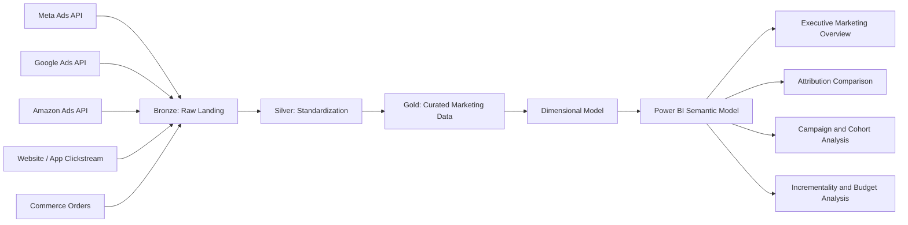
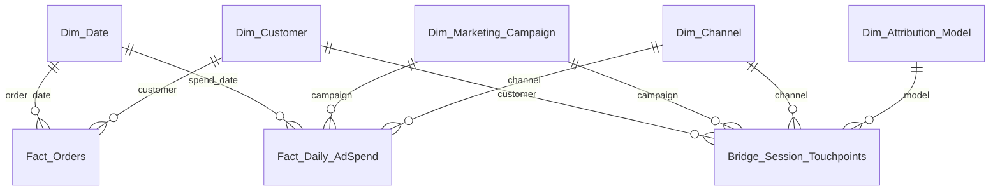

Multi-Touch Attribution & Incremental ROAS (iROAS) Optimizer


> **Project type:** Proposed enterprise analytics solution  
> **Industry:** E-Commerce  
> **Sub-domain:** Performance Marketing & Growth Analytics  
> **Primary analytical objective:** Compare cross-channel attribution,
> evaluate incremental advertising returns, and optimize marketing
> investment using profitability and customer lifetime value.
---
Table of Contents
Project Overview
Business Problem
Solution Scope and Status
Enterprise Data Architecture
End-to-End Data Flow
Medallion Architecture
Dimensional Data Model
Composite Model Architecture
Attribution Methodologies
Attribution Models
Attribution ROAS vs. Incremental
ROAS
KPI Definitions
Advanced Power BI Implementation
Field Parameters
Illustrative DAX Measures
Customer Cohort and LTV
Analysis
Custom SVG Micro-Visuals
Performance Optimization
Marketing Budget Optimization: Illustrative Business
Case
Power BI Dashboard Design
Technology Stack
Proposed GitHub Repository
Structure
Business Value and Key Takeaways
Assumptions, Limitations, and
Governance
---
Project Overview
E-commerce brands typically advertise across multiple platforms,
including Meta Ads, Google Ads, and Amazon Ads. Each platform may claim
credit for a conversion based on its own attribution rules. When these
reports are added together, the same order can be counted more than
once.
The Multi-Touch Attribution & Incremental ROAS (iROAS) Optimizer is
a proposed centralized marketing analytics solution designed to bring
advertising spend, customer journeys, orders, attribution logic, and
profitability analysis into a consistent analytical framework.
The solution is intended to help marketing and finance stakeholders
answer questions such as:
Which channels and campaigns participate in customer journeys?
How does revenue allocation change under First-Touch, Last-Touch,
Linear, and Time-Decay models?
Which campaigns generate attributed revenue, and which produce
incremental revenue?
Are campaigns contributing to net profit after product costs and
marketing investment?
How do acquisition costs compare with customer lifetime value?
Where should the marketing budget be reallocated?
Solution at a Glance
Area	Proposed capability
Data integration	Advertising platform extracts, clickstream events, and order transactions
Data engineering	Bronze, Silver, and Gold medallion layers
Data modeling	Dimensional model with a session-touchpoint bridge
Attribution	First-Touch, Last-Touch, Linear, and Time-Decay
Measurement	Attributed ROAS and experiment-based incremental ROAS
BI	Power BI semantic model, DAX measures, and executive dashboards
Optimization	Campaign profitability, CAC, LTV, payback, and budget allocation analysis
Business Problem
Advertising platforms report conversions and revenue independently.
Their reported results can overlap because multiple platforms may
interact with the same customer journey and each may claim credit for
the resulting order.
This creates several business challenges:
Double-counting conversions across advertising platforms.
Inconsistent attribution methodologies and attribution windows.
Difficulty comparing First-Touch, Last-Touch, and Time-Decay
attribution.
Optimizing campaigns using revenue rather than contribution or net
profit.
Limited visibility into incremental advertising returns.
High-cardinality clickstream data containing potentially hundreds of
millions of session records.
Different currencies, reporting periods, time zones, and attribution
windows.
Difficulty connecting customer acquisition cost with long-term
customer lifetime value.
The proposed framework centralizes measurement definitions and makes
attribution assumptions visible. It does not treat platform-reported
conversions as additive truth, nor does it assume that an attribution
model proves causality.
Solution Scope and Status
This repository describes a solution architecture and implementation
blueprint. No source dataset, deployed Fabric workspace, Databricks
pipeline, Power BI report, benchmark, or experiment result has been
supplied as evidence of a completed implementation.
Accordingly:
Architecture diagrams and repository folders are proposals.
Table names represent a recommended logical model, not a verified
physical schema.
DAX and SQL-style examples are illustrative and require adaptation to
the implemented schema.
Business-case values and scenarios are hypothetical.
No measured performance gain, ROI, or business outcome is claimed.
The technology choices are alternatives where indicated. Microsoft
Fabric and Azure Databricks are not assumed to be deployed together.
---
Enterprise Data Architecture
End-to-End Data Flow
The target architecture ingests advertising, behavioral, and
transactional data, standardizes it through medallion layers, and
exposes curated analytical models to Power BI.

Architectural flow:
Extract source data from advertising platforms, digital analytics
instrumentation, and commerce systems.
Preserve source payloads and ingestion metadata in the Bronze layer.
Standardize identifiers, timestamps, currencies, campaign metadata,
and customer/session journey records in Silver.
Apply validated business rules and create curated analytical facts
in Gold.
Build a dimensional semantic model for reusable measures and
governed reporting.
Use Power BI to deliver executive analysis, drill-through, and
controlled self-service exploration.
Medallion Architecture
The Medallion Architecture separates raw ingestion from standardized
data and business-ready analytical outputs.
Layer	Purpose	Typical responsibilities	Example outputs
Bronze	Preserve source data in its original or minimally transformed form	API extraction, raw event landing, ingestion timestamps, source metadata, replayability, schema capture	Raw ad-platform extracts, clickstream events, order extracts
Silver	Create consistent, validated, conformed data	Data type standardization, deduplication, identity resolution, sessionization, currency normalization, time-zone handling, campaign mapping, data-quality checks	Cleaned orders, normalized spend, canonical events, reconstructed journeys
Gold	Publish business-ready analytical structures	Attribution calculations, touchpoint weighting, session-level and campaign-level aggregates, profitability metrics, conformed dimensions, reporting facts	`Fact_Orders`, `Fact_Daily_AdSpend`, `Bridge_Session_Touchpoints`, aggregate tables
Bronze considerations
Retain source identifiers and source-reported values for traceability.
Record ingestion time and source extraction window.
Design ingestion to support late-arriving data and reprocessing.
Keep raw data access restricted where it contains personal or
sensitive identifiers.
Silver considerations
Standardize campaign, channel, customer, session, and order keys.
Deduplicate using documented source-specific event identity rules.
Define session boundaries and cross-device identity rules explicitly.
Normalize currencies using a governed exchange-rate source and a
documented rate date.
Retain event time separately from ingestion time to support
late-arriving events.
Quarantine records that fail critical validation rather than silently
dropping them.
Gold considerations
Generate one consistent touchpoint representation for each eligible
journey interaction.
Calculate attribution weights for each selected attribution model and
attribution window.
Ensure allocated conversion credit reconciles to the eligible order
population.
Publish facts at documented grains and pre-aggregate common reporting
paths.
Separate observed attribution outputs from experiment-derived
incremental measurement.
Dimensional Data Model
The recommended analytical model uses order, advertising-spend, and
session-touchpoint facts with conformed dimensions.
Core logical tables
Fact tables
Table	Recommended grain	Purpose
`Fact_Orders`	One row per commerce order	Order revenue, discounts, refunds, product cost, and order-level profitability inputs
`Fact_Daily_AdSpend`	One row per date, campaign, channel, and source reporting grain	Advertising investment and platform delivery metrics
`Bridge_Session_Touchpoints`	One row per eligible touchpoint within a session or journey	Connects customer journeys to campaigns/channels and stores model-specific attribution inputs or weights
Dimension tables
Table	Purpose
`Dim_Marketing_Campaign`	Campaign attributes and campaign hierarchy
`Dim_Date`	Calendar, fiscal, and reporting-period attributes
`Dim_Channel`	Standardized marketing channel classification
`Dim_Customer`	Governed customer-level analytical attributes
`Dim_Attribution_Model`	Attribution model selection and model metadata
These are logical table names. Physical columns, key definitions, source
mappings, and data types must be finalized during implementation. Do not
assume that a column exists merely because it appears in an illustrative
measure below.
Proposed relationship concept

The diagram communicates a logical design. The exact physical
relationship implementation depends on the chosen keys, attribution
output grain, and whether attribution weights are stored by model and
window or calculated in the semantic layer.
Why a bridge table is required
A customer journey can contain multiple sessions and multiple marketing
touchpoints. A campaign can participate in many journeys, and a journey
can include many campaigns. This is a many-to-many analytical
relationship.
`Bridge_Session_Touchpoints` resolves the journey-to-touchpoint
association by representing each eligible interaction as a separate row.
It provides a controlled path for allocating order credit across the
touchpoints that participated in a journey.
A recommended touchpoint record should be identifiable by a stable
journey/session reference and touchpoint sequence or event identity. The
actual key design must be confirmed against the source data.
Attribution allocation and reconciliation
For an eligible order (o), let (T_o) be the set of eligible touchpoints
in its attribution window. For model (m), assign a weight (w_{i,m}) to
each touchpoint (i).
The allocation should satisfy:
[ {i T_o} w{i,m} = 1 ]
The attributed revenue credited to a touchpoint is:
[ AttributedRevenue_{i,m} = OrderRevenue_o w_{i,m} ]
For each eligible order and model, allocated revenue should reconcile to
the order revenue basis used by the business. Orders with no eligible
touchpoints need an explicit policy, such as an unattributed category;
they should not be silently assigned to a paid channel.
Grain and relationship design
Keep each fact table at a clearly defined, non-overlapping grain.
Avoid directly joining two fact tables at incompatible grains.
Use dimensions to filter facts through one-to-many relationships
wherever practical.
Prefer single-direction filtering from dimensions to facts.
Use the bridge to represent journey membership rather than creating
uncontrolled bidirectional paths.
Validate key uniqueness on the one-side of each relationship.
Define handling for unknown, late-arriving, and unmapped dimension
members.
Use role-playing date relationships where multiple date concepts are
required, such as order date and spend date.
Attribution windows
Attribution windows (for example, a defined number of days before
conversion) affect which touchpoints are eligible. Window definitions
should be explicit, versioned, and consistent across model comparisons.
A selected window can change the eligible touchpoint set and therefore
the resulting weights and revenue allocation.
If multiple windows are supported, the model must distinguish the window
used for each attribution result. Avoid mixing results from different
windows in a single comparison without making the selection visible.
Currency and net profit
Preserve source currency and source amount for auditability.
Convert to a reporting currency using a governed exchange-rate table
and documented conversion-date policy.
Apply the same currency policy to spend, revenue, refunds, and costs.
Define whether revenue is gross, net of discounts, or net of refunds.
Define product cost, fulfillment cost, payment fees, and other
variable costs before calculating contribution or net profit.
Do not label revenue less ad spend as net profit unless all required
cost components are included.
Composite Model Architecture
A composite model can balance interactive performance and granular
exploration when the underlying source and Power BI configuration
support it.
Component	Suggested storage approach	Rationale
Campaign/day/channel aggregates	Import	Fast response for common executive and campaign queries
Granular session/touchpoint detail	DirectQuery or a carefully governed detail model	Avoid importing all high-cardinality event rows into the semantic model
Shared dimensions	Dual where supported and appropriate	Allows dimensions to serve both imported aggregations and DirectQuery detail
Aggregation tables	Import	Serves common summarized queries without scanning granular detail
Detail drill-through	DirectQuery detail path	Provides a path to investigate selected sessions or touchpoints
User-defined aggregations can map summarized imported tables to
detailed DirectQuery tables. When a query can be answered from a
compatible aggregation, the engine may use the aggregation rather than
querying the detail source. Aggregation design must match the grouping
and summarization behavior of the measures and dimensions.
Design considerations
Import mode provides strong interactive performance but consumes model
memory and requires refresh management.
DirectQuery keeps detail in the source but depends on source
performance, query folding, concurrency, and network latency.
Dual storage mode can improve shared-dimension behavior but must be
tested to avoid unexpected query plans.
Aggregations must preserve the semantics of the measures they serve.
Detail drill-through should be selective and scoped by relevant
filters.
Validate composite-model behavior, source compatibility, security
propagation, and refresh dependencies in the target environment.
This architecture can reduce the amount of granular data held in memory
while preserving a route to detail. It does not guarantee performance;
workload testing and capacity monitoring are required.
---
Attribution Methodologies
Attribution models distribute credit for an observed conversion across
eligible marketing touchpoints. They answer how credit is allocated,
not whether advertising caused the conversion.
Let a journey have (n) eligible touchpoints and order revenue (R).
Attribution Models
1. First-Touch Attribution
Definition: Assigns all conversion credit to the first eligible
marketing touchpoint in the defined attribution window.
[ w_i =
]
Use cases: Understanding discovery and channels that introduce
customers to the brand.
Strengths: Simple to explain; highlights early journey interactions.
Limitations: Ignores subsequent interactions and can over-credit
awareness channels.
2. Last-Touch Attribution
Definition: Assigns all conversion credit to the last eligible
touchpoint before conversion.
[ w_i =
]
Use cases: Analyzing channels close to conversion and comparing with
common platform reporting conventions.
Strengths: Easy to calculate and interpret; useful for understanding
final interactions.
Limitations: Can over-credit retargeting, branded search, or other
closing interactions while under-valuing earlier discovery.
3. Linear Attribution
Definition: Splits conversion credit equally across all eligible
touchpoints.
[ w_i = ]
Use cases: A neutral multi-touch baseline when the organization does
not have evidence to justify differentiated weights.
Strengths: Recognizes every eligible touchpoint and is easy to
audit.
Limitations: Assumes every touchpoint contributes equally,
regardless of timing or influence.
4. Time-Decay Attribution
Definition: Assigns greater credit to touchpoints closer to
conversion, using a selected decay rate or half-life.
One illustrative exponential-decay formulation is:
[ u_i = 2^{-t_i / h} ]
[ w_i = ]
Where:
(t_i) is the elapsed time between touchpoint (i) and conversion.
(h) is the configured half-life.
(u_i) is the unnormalized time-decay score.
Use cases: Journeys where more recent interactions are expected to
receive greater descriptive credit.
Strengths: Reflects recency and distributes credit across the
journey.
Limitations: Results depend on the selected half-life and do not
prove that recent touchpoints caused the conversion.
Attribution Model Comparison
Model	Credit allocation	Main analytical lens	Key limitation
First-Touch	100% to first eligible touchpoint	Discovery	Ignores later interactions
Last-Touch	100% to last eligible touchpoint	Conversion proximity	Undervalues earlier interactions
Linear	Equal share across eligible touchpoints	Full journey participation	Assumes equal influence
Time-Decay	Higher share to more recent touchpoints	Recency	Depends on decay configuration
All four models should use the same eligible order population, revenue
basis, identity rules, and attribution window when their outputs are
compared. Otherwise, differences may reflect inconsistent populations
rather than model logic.
Attribution ROAS vs. Incremental ROAS
Attributed ROAS compares revenue allocated to advertising under a
selected attribution model with advertising spend:
[ AttributedROAS_m = ]
It is a descriptive allocation metric. It depends on the selected
attribution rules and does not establish what would have happened
without the advertising.
Incremental ROAS (iROAS) compares revenue caused by advertising with
the incremental advertising cost:
[ iROAS = ]
A common experiment-based estimate is:
[ IncrementalRevenue = Revenue_{Exposed} - Revenue_{Control,Adjusted}
]
The adjustment may be needed to account for different group sizes or
pre-defined experimental design. The exact estimator must follow the
experiment protocol.
True incrementality requires a credible measurement methodology, such as
randomized holdout testing or a defensible causal-inference design.
Attribution models alone cannot establish incrementality. A comparison
of exposed and control groups must account for randomization,
contamination, sample size, test duration, confidence intervals, and
relevant seasonality or interference risks.
KPI Definitions
KPI	Definition	Interpretation
Total Ad Spend	Sum of normalized advertising spend in the selected scope	Investment in paid media
Attributed Revenue	Revenue allocated to touchpoints under the selected attribution model	Descriptive revenue credit
Attributed Orders	Order credit allocated under the selected model; may be fractional	Model-based conversion credit
Net Profit	Revenue less defined product, fulfillment, payment, marketing, and other included costs	Profitability under the agreed cost definition
First-Touch ROAS	First-Touch attributed revenue / ad spend	Spend efficiency under First-Touch allocation
Last-Touch ROAS	Last-Touch attributed revenue / ad spend	Spend efficiency under Last-Touch allocation
Linear ROAS	Linear attributed revenue / ad spend	Spend efficiency under Linear allocation
Time-Decay ROAS	Time-Decay attributed revenue / ad spend	Spend efficiency under Time-Decay allocation
Incremental Revenue	Estimated revenue lift caused by advertising under a valid measurement design	Causal or quasi-causal lift estimate
Incremental ROAS	Incremental revenue / incremental ad spend	Return on incremental media investment
CAC	Acquisition spend / newly acquired customers, using a defined acquisition-cost scope	Cost to acquire a customer
LTV	Defined cumulative or predicted customer value over a stated horizon	Long-term customer economics
LTV:CAC Ratio	LTV / CAC	Customer value relative to acquisition cost
MER	Total business revenue / total marketing spend, using a consistent scope	Blended marketing efficiency
Metric governance: Define whether spend includes only media or also
agency, creative, and technology costs. Define whether revenue is gross
or net of discounts, cancellations, and refunds. Specify customer
acquisition rules, LTV horizon, margin basis, reporting currency, and
date attribution before publishing KPIs.
---
Advanced Power BI Implementation
Field Parameters
Power BI Field Parameters can allow report consumers to switch the
measure or dimension displayed in a visual without maintaining separate
visuals for each selection.
A proposed attribution measure selector can expose:
First-Touch Attribution
Last-Touch Attribution
Linear Attribution
Time-Decay Attribution
An additional time-grain selector can support:
Daily
Weekly
Monthly
Quarterly
Yearly
Implementation approach
Create and validate the underlying measures for each attribution
model.
Create a Field Parameter containing the measures to compare.
Add the parameter to a slicer and use it in supported visuals.
Create a separate date-grain parameter for the date fields or
hierarchy levels.
Test totals, drill behavior, sorting, and interactions at each
grain.
Field Parameters change which fields or measures are used in visuals;
they do not calculate attribution weights by themselves. The underlying
model and measures must already support each attribution model. Weekly
reporting also requires a consistent week-start and week-year
convention.
Illustrative DAX Measures
The following examples are illustrative, not production-ready
definitions. They assume a proposed model with numeric columns such as
`Fact_Daily_AdSpend[SpendReportingCurrency]`,
`Fact_Orders[NetRevenueReportingCurrency]`, and
`Fact_Orders[NetProfitReportingCurrency]`. These column names are
examples only and must be mapped to the final physical schema.
The examples also assume that dimensions filter the relevant fact tables
through valid relationships and that the date table is marked as a date
table. Attribution measures require a valid allocation output at the
selected model and window grain.
Total Ad Spend
``` dax
Total Ad Spend :=
SUM ( Fact_Daily_AdSpend[SpendReportingCurrency] )
```
Attributed Revenue
For illustration, assume the bridge contains an allocated revenue amount
at touchpoint grain and that the selected attribution model filters the
correct allocation rows.
``` dax
Attributed Revenue :=
SUM ( Bridge_Session_Touchpoints[AllocatedRevenueReportingCurrency] )
```
This measure is valid only if allocated revenue is stored once per
touchpoint per eligible order, attribution model, and window. If the
bridge stores only weights, revenue allocation must instead be
calculated from a correctly related order-level structure without
multiplying order revenue unintentionally.
Attributed Orders
If fractional order credit is stored per touchpoint:
``` dax
Attributed Orders :=
SUM ( Bridge_Session_Touchpoints[AttributedOrderWeight] )
```
The measure returns allocated order credit, not necessarily a count of
distinct physical orders.
ROAS
``` dax
Attributed ROAS :=
DIVIDE ( [Attributed Revenue], [Total Ad Spend] )
```
For separate model comparisons, define model-specific revenue measures
or use a model selector that filters the correct allocation records.
Net Profit
``` dax
Net Profit :=
SUM ( Fact_Orders[NetProfitReportingCurrency] )
    - [Total Ad Spend]
```
This example assumes `NetProfitReportingCurrency` is order contribution
before media spend and excludes advertising cost. If the stored
column already includes media cost, subtracting spend again would
double-count it. Align the measure with the approved finance definition.
Customer Acquisition Cost (CAC)
Assume a measure `[New Customers]` counts distinct customers acquired in
the selected period under an agreed acquisition rule.
``` dax
CAC :=
DIVIDE ( [Acquisition Spend], [New Customers] )
```
`[Acquisition Spend]` should include only the spend categories defined
by the CAC policy. Do not assume all marketing spend is acquisition
spend.
Customer Lifetime Value (LTV)
An illustrative historical revenue LTV:
``` dax
Customer LTV :=
DIVIDE (
    [Customer Revenue],
    [Acquired Customers]
)
```
This is average revenue per acquired customer in the selected cohort and
observation horizon. It is not automatically predictive LTV or
margin-based LTV. For profitability decisions, use a defined
contribution-margin basis and account for incomplete customer
observation periods.
LTV:CAC Ratio
``` dax
LTV to CAC :=
DIVIDE ( [Customer LTV], [CAC] )
```
Ensure the LTV and CAC measures use compatible customer populations,
currency, and time horizons.
Marketing Efficiency Ratio (MER)
``` dax
MER :=
DIVIDE ( [Total Business Revenue], [Total Marketing Spend] )
```
MER is a blended business-level metric. It should not be interpreted as
channel-level attributed ROAS.
Incremental ROAS
Assume experiment-derived measures `[Exposed Revenue]`,
`[Adjusted Control Revenue]`, and `[Incremental Ad Spend]` have been
defined from a valid experiment dataset and design.
``` dax
Incremental Revenue :=
[Exposed Revenue] - [Adjusted Control Revenue]
```
``` dax
Incremental ROAS :=
DIVIDE ( [Incremental Revenue], [Incremental Ad Spend] )
```
These measures are meaningful only when the exposed/control populations
and adjustment method follow the experiment design. The three measures
cannot be derived from the four attribution models alone.
Previous Period ROAS
Assuming a continuous `Dim_Date` table and a valid date relationship:
``` dax
Previous Period Attributed Revenue :=
CALCULATE (
    [Attributed Revenue],
    DATEADD ( Dim_Date[Date], -1, MONTH )
)
```
``` dax
Previous Period Ad Spend :=
CALCULATE (
    [Total Ad Spend],
    DATEADD ( Dim_Date[Date], -1, MONTH )
)
```
``` dax
Previous Period ROAS :=
DIVIDE (
    [Previous Period Attributed Revenue],
    [Previous Period Ad Spend]
)
```
This example compares the equivalent prior-month date range for the
dates currently in context. If the report requires a full previous
calendar month regardless of the current selection, use a separately
defined period-selection pattern and test its filter behavior.
Customer Cohort and LTV Analysis
Cohort analysis groups customers by acquisition period and tracks their
subsequent retention, revenue, and contribution over a common
customer-age timeline.
Recommended analytical elements
Acquisition cohort: Month in which a customer first meets the
defined acquired-customer rule.
Acquisition month: Cohort label used for rows in the cohort
matrix.
Day 30 / Day 60 / Day 90: Customer outcomes measured within
defined windows after acquisition.
Cumulative net margin: Accumulated contribution after the agreed
variable costs.
Initial acquisition cost: Acquisition investment allocated to the
cohort.
LTV:CAC payback: The point at which cumulative customer
contribution offsets acquisition cost.
A cohort matrix can display acquisition month on rows and customer age
(for example, month 0, month 1, month 2, month 3) on columns. A separate
view can show day-based checkpoints such as day 30, day 60, and day 90.
Implementation approach
Determine the first qualifying acquisition date per customer using a
documented rule.
Assign each customer to an acquisition cohort.
Calculate elapsed days or months from acquisition to each subsequent
transaction.
Aggregate active customers, repeat purchase rate, revenue, and
contribution by cohort age.
Allocate acquisition cost to the cohort using an explicit policy.
Compare cumulative contribution with acquisition cost to estimate
payback.
Disconnected parameter tables can provide user-selectable horizons
(30/60/90 days), cohort-age buckets, or metric choices. Measures read
the selected parameter and apply the corresponding date window. The
parameter table should not create an unintended relationship to the fact
tables.
Important interpretation notes
Recent cohorts are right-censored: they have not had the same
observation time as older cohorts.
Day 30, 60, and 90 values should be blank or clearly marked when the
full observation window is not yet available.
Revenue LTV and contribution LTV are different metrics.
A payback calculation requires customer-level or cohort-level
contribution and acquisition cost on compatible bases.
Retention definitions (purchase activity, active account, or another
event) must be documented.
Custom SVG Micro-Visuals
Power BI measures can return SVG data URIs for display in visuals that
support image URLs. This can create compact visual elements such as:
14-day ROAS trend sparklines.
Campaign spend-pacing indicators.
Conditional performance indicators.
Small trend visuals inside campaign matrices.
The following is a simplified illustrative sparkline pattern. It assumes
a measure `[Daily ROAS]`, a date table, and a visual context containing
one campaign. Validate the generated SVG and encoding in the target
Power BI visual.
``` dax
ROAS Sparkline SVG :=
VAR Points =
    ADDCOLUMNS (
        DATESINPERIOD (
            Dim_Date[Date],
            MAX ( Dim_Date[Date] ),
            -14,
            DAY
        ),
        "@Value", CALCULATE ( [Daily ROAS] )
    )
VAR ValidPoints =
    FILTER ( Points, NOT ISBLANK ( [@Value] ) )
VAR MinValue =
    MINX ( ValidPoints, [@Value] )
VAR MaxValue =
    MAXX ( ValidPoints, [@Value] )
VAR PointCount =
    COUNTROWS ( ValidPoints )
VAR Coordinates =
    CONCATENATEX (
        ADDCOLUMNS (
            ValidPoints,
            "@X",
                4
                    + DIVIDE (
                        RANKX ( ValidPoints, Dim_Date[Date], , ASC, DENSE ) - 1,
                        MAX ( PointCount - 1, 1 )
                    ) * 92,
            "@Y",
                26
                    - DIVIDE ( [@Value] - MinValue, MaxValue - MinValue, 0.5 ) * 22
        ),
        FORMAT ( [@X], "0.0" ) & "," & FORMAT ( [@Y], "0.0" ),
        " "
    )
VAR SvgText =
    IF (
        PointCount < 2,
        BLANK (),
        "<svg xmlns='http://www.w3.org/2000/svg' width='100' height='30' viewBox='0 0 100 30'>"
            & "<polyline fill='none' stroke='%230078D4' stroke-width='2' points='"
            & Coordinates
            & "'/></svg>"
    )
RETURN
    IF (
        ISBLANK ( SvgText ),
        BLANK (),
        "data:image/svg+xml;utf8," & SvgText
    )
```
SVG implementation notes
Set the measure’s data category to Image URL where supported.
Encode reserved characters correctly for a data URI. In particular,
`#` in a color value must be URI-encoded as `%23`.
Keep SVG markup minimal and use a fixed `viewBox` to control scaling.
Test blank values, a single data point, constant series, and negative
values.
SVG rendering support can vary by visual and export path; validate in
Power BI Desktop and the Service.
Avoid embedding untrusted text or user-controlled markup in SVG
output.
---
Performance Optimization
The data volume and high cardinality of clickstream events require
deliberate storage, transformation, and semantic-model design.
Technique	Recommended approach	Expected architectural benefit
High-cardinality clickstream optimization	Keep only required analytical attributes in the semantic model; use efficient types and source-side filtering	Reduces model size and unnecessary scan work
Session-touchpoint pre-aggregation	Aggregate repeatable analytical patterns at session/touchpoint grain	Reduces repeated transformation and query work
Composite model	Import common aggregates and use DirectQuery for selected detail	Balances summary performance and detail access
User-defined aggregations	Map imported summaries to compatible detail tables	Allows eligible queries to be answered from aggregates
Dual dimensions	Use Dual only for dimensions shared across Import and DirectQuery paths	Supports efficient filtering across storage modes
DAX optimization	Prefer clear filter context, variables where useful, and measures that avoid unnecessary row-by-row iteration	Reduces avoidable formula-engine work
Star schema	Use conformed dimensions and facts at explicit grains	Simplifies filter propagation and measure behavior
Relationship design	Prefer single-direction relationships; use bidirectional filtering only when justified and tested	Reduces ambiguity and expensive filter propagation
Many-to-many control	Resolve journey membership through a governed bridge and explicit allocation logic	Avoids uncontrolled many-to-many calculations
Incremental refresh	Partition large refreshable fact tables by a suitable date column and configure retention policies	Limits routine refresh scope when supported by the source and model
Source optimization	Use query folding, source indexes, partitioning, and curated views where applicable	Pushes suitable work closer to the data
Monitoring	Inspect query plans, refresh duration, capacity utilization, and user query patterns	Identifies actual bottlenecks before tuning
Performance Engineering Principles
Design for the question, not the raw event count. Most executive
questions are answered by campaign/day/channel aggregates rather
than individual clickstream rows.
Preserve detail selectively. Keep a drill-through route to
granular data, but avoid exposing every event to every report
visual.
Validate aggregation coverage. An aggregation only helps when
the query can be answered correctly from its grain and stored
summarizations.
Protect semantic correctness. Performance shortcuts must not
change attribution allocation, currency conversion, or revenue
definitions.
Measure before and after. Use representative workloads and
record refresh/query baselines before claiming an improvement.
No measured performance improvements are claimed because no benchmark
results have been provided.
---
Marketing Budget Optimization: Illustrative Business Case
Scenario (illustrative only): The marketing team evaluates
reallocating 15% of advertising spend away from low-incrementality
branded search campaigns and toward acquisition channels associated with
higher-LTV customers.
The 15% is a scenario input, not a reported result or a recommendation
to make the change without testing.
Evaluation Framework
Evaluation area	Questions to answer
Incremental revenue impact	Does the destination channel generate additional revenue relative to a credible control or baseline?
Net profit contribution	Does incremental contribution remain positive after product, fulfillment, payment, and media costs?
Blended MER	Does total business revenue relative to total marketing spend improve or deteriorate?
CAC	Does the reallocation change the cost of acquiring a genuinely new customer?
Customer lifetime value	Do acquired customers generate higher contribution over a comparable observation horizon?
Payback period	How long does cumulative customer contribution take to recover acquisition cost?
Channel profitability	Which channels produce attractive incremental contribution, not merely high attributed revenue?
Decision Process
Establish the current spend allocation and document the
campaign/channel scope.
Identify campaigns with weak incremental evidence; do not classify a
campaign as low-incrementality solely because an attribution model
assigns it less credit.
Estimate the potential 15% reallocation and define the destination
channels.
Use randomized holdouts or another defensible causal design to
estimate incremental effects where feasible.
Compare incremental revenue and contribution, CAC, cohort LTV, and
payback across comparable populations.
Monitor blended business outcomes and guardrails such as total
revenue, margin, and customer quality.
Scale, revise, or reverse the allocation based on statistically and
commercially credible evidence.
A channel with high LTV customers may still be unattractive if
acquisition costs are too high or payback is too slow. Similarly, a
channel with strong attributed ROAS may have low incrementality if it
captures demand that would have converted without the advertising.
---
Power BI Dashboard Design
The proposed report contains six pages designed for executive oversight
and analytical investigation.
Page 1: Executive Marketing Overview
Purpose: Provide a consolidated view of marketing investment,
revenue allocation, efficiency, and profitability.
Suggested visuals and KPIs
Total Ad Spend
Attributed Revenue
Blended MER
Incremental ROAS, where valid experiment results are available
Net Profit under the agreed finance definition
Campaign performance and spend/revenue trends
Key insights: Whether marketing investment and business outcomes are
moving together, where performance changes occur, and whether the
displayed return is attributed or incremental.
Page 2: Attribution Model Comparison
Purpose: Show how conversion credit changes when different
attribution assumptions are applied.
Suggested visuals
First-Touch vs. Last-Touch vs. Linear vs. Time-Decay comparison
Channel contribution analysis
Revenue allocation by campaign and channel
Attribution model and attribution-window selectors
Key insights: Which channels are emphasized or de-emphasized by each
model, and how sensitive channel rankings are to attribution
assumptions.
Page 3: Campaign Performance
Purpose: Enable campaign-level monitoring and investigation.
Suggested visuals
Campaign-level attributed ROAS
Spend versus attributed revenue
Conversion and attributed-order performance
14-day ROAS sparklines
Campaign spend-pacing indicators
Key insights: Which campaigns are over- or under-performing against
defined targets, where spend is pacing differently from plan, and which
campaigns need further investigation.
Page 4: Incrementality Analysis
Purpose: Separate observed conversion credit from measured
advertising lift.
Suggested visuals
Incremental revenue
Incremental advertising cost
Incremental ROAS
Exposed versus holdout audience outcomes
Experiment metadata and uncertainty indicators where available
Key insights: Whether advertising generated additional outcomes
beyond the control condition. The page should display experiment scope,
dates, audience definition, and measurement caveats alongside results.
Page 5: Customer Cohort & LTV Analysis
Purpose: Understand the quality and longer-term economics of
acquired customers.
Suggested visuals
Acquisition cohort matrix
Day 30 / 60 / 90 contribution or net margin
LTV:CAC
Payback period
Retention and repeat-purchase trends
Key insights: Which acquisition cohorts retain, purchase again, and
recover acquisition cost over time. Comparisons should account for
cohort maturity.
Page 6: Marketing Budget Optimization
Purpose: Support scenario analysis and evidence-based investment
allocation.
Suggested visuals
Channel profitability
Budget allocation opportunities
High-LTV acquisition channel analysis
Low-incrementality campaign investigation
Scenario-based investment recommendations
Key insights: Where budget changes may improve incremental
contribution and customer economics. Scenario outputs should be clearly
separated from observed results and validated experiments.
---
Technology Stack
The following stack describes the proposed solution options. It does not
assert that any component has been deployed.
Category	Technology	Status / role
Data Engineering	Microsoft Fabric	Proposed unified analytics platform option
Data Engineering	Azure Databricks	Alternative or complementary compute option, subject to platform design
Data Architecture	Medallion Architecture	Proposed Bronze / Silver / Gold organization
Data Transformation	PySpark / SQL	Proposed transformation languages
Data Storage	Delta Lake / Lakehouse	Proposed analytical storage pattern
Data Modeling	Dimensional Modeling / Star Schema	Recommended semantic modeling approach
BI & Visualization	Power BI Desktop / Power BI Service	Proposed reporting and semantic-model layer
Analytical Language	DAX	Measures and semantic calculations
Data Transformation	Power Query	Data preparation and connectivity where appropriate
Data Connectivity	Import / DirectQuery / Composite Models	Storage and connectivity options
Performance Optimization	User-Defined Aggregations / Dual Storage Mode	Optional model optimization capabilities
Version Control	Git / GitHub	Source control and project documentation
Platform selection note: Fabric and Databricks can both support
lakehouse-oriented engineering patterns, but selecting both introduces
integration, governance, orchestration, and cost considerations. Choose
the platform based on existing enterprise standards, workload
requirements, skills, security, and operational ownership.
---
Proposed GitHub Repository Structure
The following is a suggested organization for future implementation
artifacts. It is not a statement that these folders or files currently
exist.
``` text
Multi-Touch-Attribution-iROAS-Optimizer/
│
├── README.md
│
├── Architecture/
│   ├── Data_Architecture.md
│   ├── Data_Model_Diagram.png
│   └── Medallion_Architecture.png
│
├── Data/
│   ├── Bronze/
│   ├── Silver/
│   └── Gold/
│
├── SQL/
│   ├── Data_Transformation.sql
│   └── Attribution_Logic.sql
│
├── DAX/
│   ├── Core_Measures.dax
│   ├── Attribution_Measures.dax
│   └── Cohort_Analysis.dax
│
├── PowerBI/
│   ├── Dashboard_Screenshots/
│   └── PowerBI_Model_Documentation.md
│
└── Documentation/
    ├── Business_Requirements.md
    └── Technical_Documentation.md
```
Add artifacts only when they have been created, reviewed, and are
suitable for publication. Do not commit credentials, API tokens,
customer-level personal data, or confidential source extracts.
---
Business Value and Key Takeaways
The proposed solution establishes a governed foundation for
cross-channel marketing measurement.

Business value	How the solution supports it
Unified cross-channel measurement	Standardizes advertising spend, orders, campaign metadata, and customer journeys
Reduced attribution overlap	Applies a common eligible-touchpoint population and explicit credit-allocation rules
Better acquisition-efficiency visibility	Connects acquisition spend and newly acquired customers through governed CAC definitions
Profitability-focused optimization	Adds contribution and cost context to revenue-based campaign reporting
Incremental-return visibility	Separates attribution outputs from experiment-based lift measurement
Better budget allocation	Combines incrementality, customer value, CAC, and payback analysis
Scalable analytics architecture	Uses layered data engineering, dimensional modeling, and aggregation strategies
Executive decision support	Presents consistent KPIs and model assumptions through focused Power BI pages
Key Takeaways
Platform-reported conversions should not be added together without
reconciling overlapping customer journeys.
Attribution models provide alternative ways to allocate observed
conversion credit; they do not establish causal impact.
Incremental ROAS requires a credible experiment or causal-inference
methodology.
Revenue, contribution, and net profit must remain distinct and
consistently defined.
Customer economics require cohort maturity, comparable horizons, and
clear CAC/LTV policies.
A well-designed semantic model and aggregation strategy are essential
for balancing high-volume detail with executive reporting needs.
---
Assumptions, Limitations, and Governance
Data and identity assumptions
Source systems provide sufficiently reliable order, spend, campaign,
and event identifiers.
Customer and session identity stitching follows approved privacy,
consent, and governance rules.
Cross-device identity is not assumed to be complete.
Platform attribution windows and conversion definitions may differ and
must be documented before comparison.
Measurement assumptions
Attribution comparisons use a consistent eligible order population,
currency basis, and reporting period.
Attribution weights reconcile to 100% for each eligible order and
model.
Unattributed orders are retained and reported according to an explicit
policy.
Incrementality results are only published when an approved measurement
design and usable experiment data exist.
Statistical uncertainty and test limitations should accompany
experimental results.
Financial definitions
Revenue basis (gross, net of discounts, net of refunds) must be agreed
with Finance.
Net profit requires an explicit list of included costs.
CAC must define which acquisition costs are included and what
qualifies as a newly acquired customer.
LTV must specify revenue or margin basis, observation/prediction
horizon, and treatment of incomplete cohorts.
MER must use consistent total-revenue and total-marketing-spend
scopes.
Security and governance
Apply least-privilege access to raw clickstream and customer data.
Use row-level security where business requirements call for restricted
audience or market access.
Protect personally identifiable information and follow applicable
consent and retention policies.
Maintain lineage from source extracts through curated facts and
semantic measures.
Version business definitions, attribution windows, and experiment
protocols.
Document refresh ownership, data-quality thresholds, and
failure-handling procedures.
Implementation validation checklist
Before treating this blueprint as a production solution, validate:
Source availability, API limits, extraction completeness, and
licensing.
Physical table grains, primary keys, foreign keys, and referential
integrity.
Customer/session identity and deduplication logic.
Attribution eligibility, window boundaries, and weight reconciliation.
Currency conversion and finance-approved profitability definitions.
Experiment design and incremental measurement methodology.
Power BI storage modes, aggregation mappings, security, and refresh
behavior.
Representative query performance, refresh performance, and capacity
requirements.
---
Project status: Architecture and analytical design blueprint.
Implementation status, dataset contents, measured results, and
production readiness should be updated only when supported by verifiable
project artifacts and testing.
